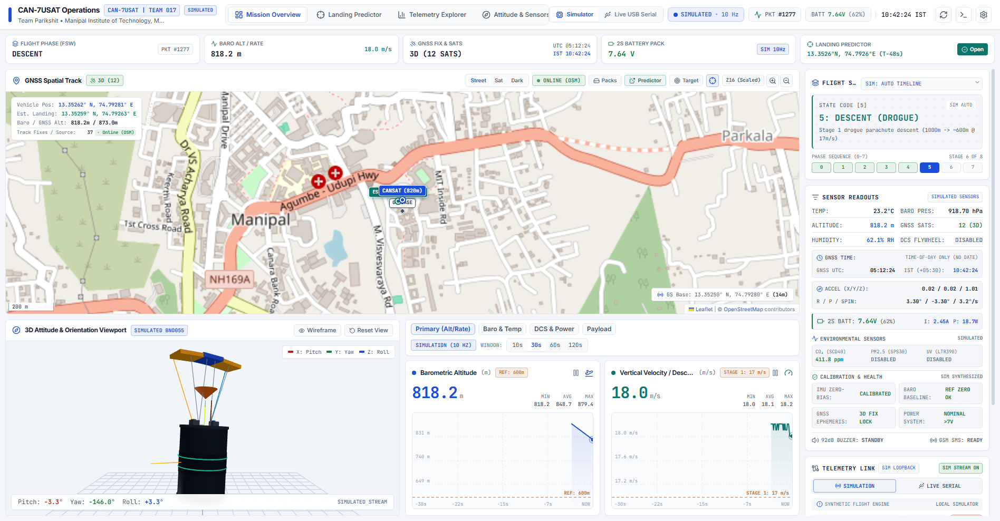
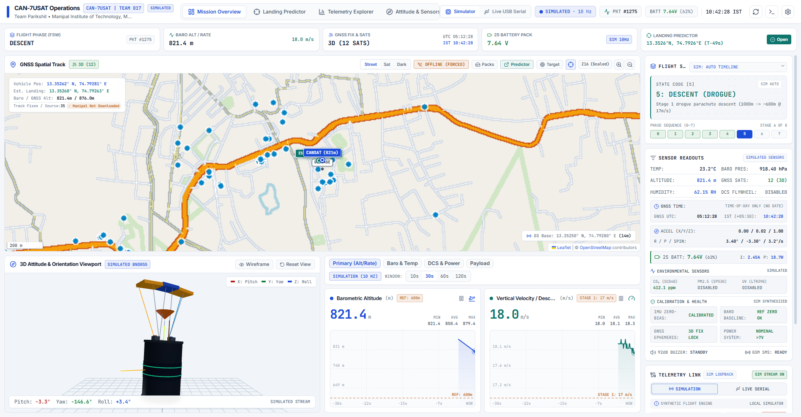
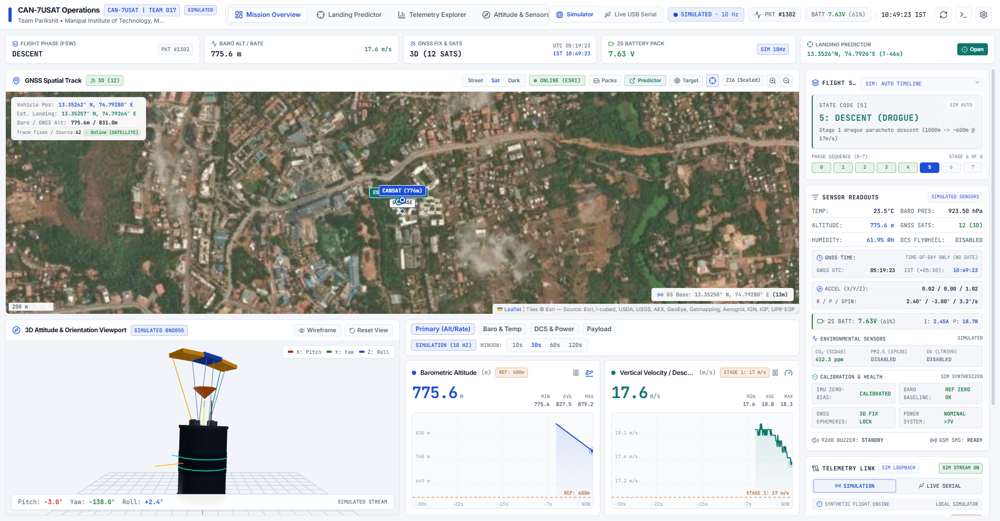
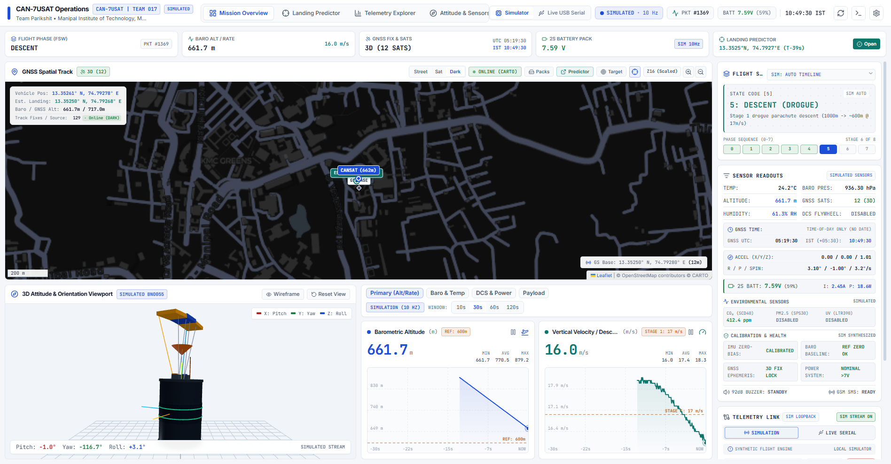
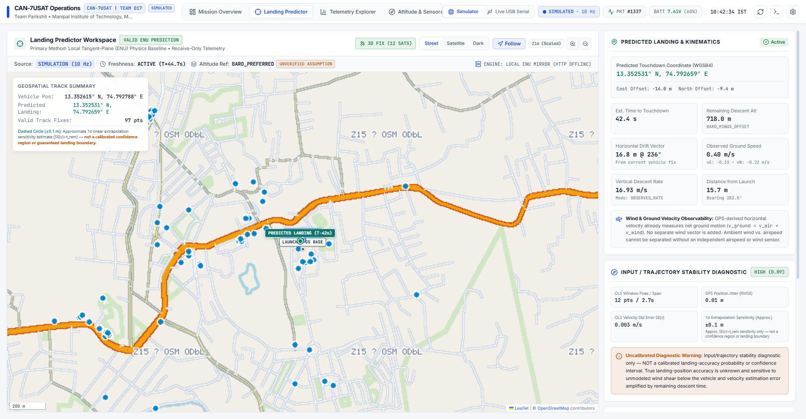

# CAN-7USAT Ground Control Station (GCS)

[](https://nodejs.org/)
[](https://www.typescriptlang.org/)
[](https://react.dev/)
[](https://vitejs.dev/)
[](https://threejs.org/)
[](https://leafletjs.com/)
[](https://www.python.org/)
[](docs/ground_station_compliance.md)

> **Engineering Portfolio & Project Context:**  
> This Ground Control Station was developed independently by the author as part of **Team Parikshit (Team 017 | `2026-IN-SPACe-CAN-7USAT-017`)** representing the **Manipal Institute of Technology (MIT), Manipal Academy of Higher Education (MAHE)** for the **IN-SPACe CAN-7USAT India Student Competition (3rd Edition, 2026–27)** organized by the Indian National Space Promotion and Authorization Centre (IN-SPACe), Government of India.  
> Team consent is confirmed for shared team assets and competition identifiers. Formal institutional clearance has not been established; standard student work ownership applies absent specific agreements or substantial institutional resource policies.  
> The software has been tested against synthetic flight simulations, flat-sat bench hardware, and local field test data. Final full-envelope atmospheric flight qualification remains subject to upcoming field launch tests.

---

## 1. Overview & Purpose

The CAN-7USAT Ground Control Station (GCS) is a high-reliability avionics mission dashboard designed to ingest, process, visualize, and record real-time 10 Hz telemetry transmitted by a 7U-class CanSat during rocket ascent, apogee separation, two-stage parachute descent, and ground recovery.

Key engineering goals:
- **Low-Latency Telemetry Ingestion:** Sub-100ms parse and render loop from raw USB-UART / LoRa serial packets via the Web Serial API.
- **Zero-Internet Field Readiness:** Guaranteed offline operations at remote launch and recovery sites (Kushinagar, Tamkuhi Raj) using local SQLite MBTiles raster packages and a self-hosted Node.js tile server.
- **6-DOF Kinematic Visualization:** Live 3D spatial attitude rendering using Three.js / WebGL driven by onboard IMU orientation quaternions and Tait-Bryan angles.
- **Precision Landing Estimation:** Deterministic Local Tangent-Plane (East-North-Up) trajectory propagation with sliding-window ordinary least squares (OLS) horizontal drift regression and conservative GPS validity gates.
- **Official Competition Compliance:** Automated compliance logging and CSV export strictly formatted according to IN-SPACe Competition Guidelines Section 6.1 & 6.3 (`Flight_2026-IN-SPACe-CAN-7USAT-017.csv`).

---

## 2. Screenshots

### Mission Overview — Online Geographic Basemap
Real-time 10 Hz telemetry dashboard featuring barometric altitude charts, vertical descent velocity, 3D attitude viewport, live GPS tracking, and radio link monitoring:


### Zero-Internet Field Operations — Local MBTiles Offline Map
Seamless raster map rendering served locally from SQLite MBTiles via Node.js (`127.0.0.1:8080`) with zero external internet access:


### Satellite Imagery Basemap (Esri World Imagery)
High-resolution satellite basemap overlay for terrain and landcover situational awareness:


### High-Contrast Dark Basemap (CartoDB Dark)
Unified dark palette basemap matching the avionics control room aesthetics:


### Precision Landing Predictor Workspace
Local Tangent-Plane (ENU) physics propagation, two-stage descent phase modeling (drogue $\sim 17\text{ m/s}$ $\rightarrow$ main/parafoil $\sim 2.2\text{ m/s}$), horizontal drift vector calculation, and trajectory stability metrics:


---

## 3. Main Features

- **Multi-Source Telemetry Streaming:**
  - `LIVE_SERIAL`: Direct USB-UART connection to LoRa ground transceivers using the browser Web Serial API with configurable baud rate (default 115200), split-packet chunk reassembly, and CR/LF overflow protection.
  - `SIMULATION`: Deterministic 10 Hz flight profile simulation traversing all 8 flight states for bench testing, operator rehearsal, and UI validation.
  - Strict source isolation ensures simulator packets never contaminate live flight logs or competition export files.
- **3D Attitude & Orientation Viewport:**
  - 6-DOF WebGL visualization using `@react-three/fiber` and Three.js.
  - Synchronized Euler angles (Pitch $\pm 180^\circ$, Roll $\pm 180^\circ$, Yaw $0\text{--}360^\circ$) with orbital camera controls and instant view reset.
- **Resilient Multi-Basemap Subsystem:**
  - Three distinct basemap styles: OpenStreetMap Standard, Esri World Imagery (Satellite), and CartoDB Dark.
  - Native auto-scaling (`maxNativeZoom: 15`, `maxZoom: 19`) ensures deep zooming without visual degradation or coordinate corruption.
  - Automatic transition between online tile sources and local offline MBTiles storage.
  - Missing-tile indicator automatically adapts to theme (`isDark`), eliminating jarring rectangular artifacts.
- **Precision Landing Predictor (ENU Tangent-Plane):**
  - Real-time touchdown coordinate forecasting using linear horizontal drift extrapolation and two-stage descent rates.
  - Strict validity gates: rejects $(0, 0)$ "Null Island" coordinates, stale fixes ($>3.0\text{s}$), non-descending flight phases, and supersonic GPS anomalies.
  - Trajectory stability diagnostics reporting horizontal jitter RMSE, OLS velocity standard error, and time-to-touchdown ($T_{\text{rem}}$).
  - Dual architecture: synchronous TypeScript fallback client coupled with an optional Python HTTP microservice.
- **Avionics Health & Flight State Machine:**
  - Automatic flight phase detection: `LAUNCH_PAD` $\rightarrow$ `ASCENT` $\rightarrow$ `ROCKET_SEPARATION` $\rightarrow$ `DESCENT_DROGUE` $\rightarrow$ `DESCENT_MAIN` $\rightarrow$ `LANDED`.
  - Discontinuity detection logic flags flight processor resets, packet drops, or counter rollbacks.
  - Configurable optional telemetry fields (e.g. 2S battery pack voltage, environmental payload sensors).
- **Official IN-SPACe Section 6.3 CSV Logging:**
  - One-click export of `Flight_2026-IN-SPACe-CAN-7USAT-017.csv` containing all 34 canonical fields with UTC and IST (+05:30) timestamps, pressure converted from Pa to hPa, and CSV injection sanitization.

---

## 4. Architecture & Telemetry Data Flow

```mermaid
flowchart TD
    subgraph Inputs["Telemetry Ingestion"]
        HW["Hardware Transceiver (SX1262 LoRa 866.5 MHz)"] -->|USB Serial @ 115200| WS["Web Serial API Line Buffer"]
        SIM["Synthetic Flight Engine (10 Hz)"] --> SIM_BUF["Simulation Packet Buffer"]
    end

    subgraph Core["State & Validation Gate"]
        WS --> PARSER["telemetryParser.ts\n• 19-field CSV validation\n• Trailing comma tolerance\n• (0,0) GPS rejection\n• Unit conversion (Pa → hPa)"]
        SIM_BUF --> PARSER
        PARSER --> FILTER{"Source Isolation Gate\n(LIVE_SERIAL vs SIM)"}
        FILTER --> STATE["React Telemetry State Store"]
    end

    subgraph Visualization["UI Workspaces & Viewports"]
        STATE --> OVERVIEW["Mission Overview Panel\n• Baro / GNSS Alt\n• Descent Rate\n• Battery & Health"]
        STATE --> THREE_D["ThreeAttitudeViewport.tsx\n• Three.js 6-DOF CanSat\n• Euler Angles (R/P/Y)"]
        STATE --> CHARTS["TelemetryChartPanel.tsx\n• Sliding Window (10-120s)\n• Reset Detection Traces"]
        STATE --> MAP["GpsTrackingMap.tsx\n• Live GPS Breadcrumbs\n• Target & GS Markers\n• Bounding Box Overlays"]
    end

    subgraph Predictor["Precision Landing Engine"]
        STATE --> COORD["PredictorRequestCoordinator.ts\n• Request Throttling\n• Exponential Backoff"]
        COORD --> TS_ENG["landingPredictorClient.ts\n(Deterministic ENU Fallback)"]
        COORD -.->|HTTP JSON (Local)| PY_ENG["predictor_service/\n(Python 3.10+ Physics Engine)"]
        TS_ENG --> PRED_VIEW["LandingPredictorWorkspace.tsx\n• Touchdown Forecast\n• Drift Vector & Jitter RMSE"]
        PY_ENG -.-> PRED_VIEW
    end

    subgraph OfflineStorage["Offline Map Pipeline"]
        MBTILES["SQLite MBTiles Databases\n(manipal, kushinagar, tamkuhi_raj)"] --> NODE_SRV["server/offlineServer.mjs\n(127.0.0.1:8080)"]
        NODE_SRV --> IDB["IndexedDB Cache\n(cansat_offline_maps_v2)"]
        IDB --> MAP
        NODE_SRV --> MAP
    end

    subgraph Export["Competition Logging"]
        STATE --> CSV_EXP["telemetryExport.ts\n• Flight_2026-IN-SPACe-CAN-7USAT-017.csv\n• 34 Canonical Columns"]
    end
```

---

## 5. Technology Stack

| Layer | Technologies | Role |
| :--- | :--- | :--- |
| **Frontend Framework** | React 19, TypeScript 5.8, Vite 6 | Core reactive component architecture and high-performance compilation |
| **Styling & Icons** | Tailwind CSS 4, Lucide React | High-contrast avionics design tokens and accessible iconography |
| **3D Graphics** | Three.js (r185), `@react-three/fiber`, `@react-three/drei` | Real-time WebGL attitude visualization of the CanSat airframe |
| **Mapping Engine** | Leaflet 1.9, `react-leaflet` 5 | Interactive 2D spatial tracking, vector breadcrumbs, and tile layers |
| **Telemetry Ingestion** | Web Serial API, Custom chunking line buffer | Direct browser-to-USB communication without intermediary desktop agents |
| **Offline Map Server** | Node.js 24 (`node:http`, `node:sqlite` `DatabaseSync`) | Zero-dependency local MBTiles tile serving (`http://127.0.0.1:8080`) |
| **Predictor Backend** | Python 3.10+ (Standard Library only), `pytest` 9 | Standalone HTTP microservice for landing trajectory propagation |
| **Testing** | Node.js Test Runner (`node --test`), `tsx`, `pytest` | 72 unit/integration frontend tests and 14 Python physics tests |

---

## 6. Installation & Development Setup

### Prerequisites
- **Node.js:** v20.12.0 or newer (v22 / v24 recommended)
- **npm:** v10 or newer
- **Python:** v3.10 or newer (for running the Python landing predictor service or its test suite)
- **Git**

### Step-by-Step Setup
1. **Clone the repository:**
   ```bash
   git clone https://github.com/Rushil1506/CAN7USAT-ground-control-station.git
   cd cansat-ground-control-station
   ```

2. **Install frontend dependencies:**
   ```bash
   npm install
   ```

3. **Configure environment variables (optional):**
   ```bash
   cp .env.example .env.local
   ```
   *(Note: The GCS functions fully offline without any API keys. `VITE_CARTO_API_KEY` is optional for CARTO Dark tiles).*

---

## 7. How to Run the GCS Locally

### Standard Online Development Mode
Starts the Vite development server with hot-module replacement on port 3000:
```bash
npm run dev
```
Open your browser to: **`http://localhost:3000`**

### Running the Full Offline Field Stack
To run the complete zero-internet stack (Vite dashboard + local MBTiles offline tile server):

**On Windows (PowerShell):**
```powershell
.\start_offline_gcs.ps1
```

**On Windows (Command Prompt):**
```cmd
start_offline_gcs.bat
```

**On Linux / macOS:**
```bash
# Terminal 1: Start local offline tile server
node server/offlineServer.mjs 8080

# Terminal 2: Start GCS dashboard
npm run dev
```

### Running the Optional Python Predictor Microservice
The GCS contains a built-in TypeScript ENU physics predictor that runs synchronously in the browser. If you wish to run the standalone Python predictor server:
```bash
python -m predictor_service.server --port 8000
```

---

## 8. Offline Map System & MBTiles Setup

> [!NOTE]
> **Geographic Map Databases Are Excluded From Version Control:**  
> To keep the repository lightweight and adhere to data redistribution boundaries, binary `.mbtiles` packages and raw XML map data are **not tracked in this Git repository**. The ground station connects dynamically to any local MBTiles packages placed in the `map_packs/` folder.

### Regional Operational Boundaries
The GCS is pre-configured to recognize three regional offline mission areas:
1. **Manipal Test Bench & Field (MIT Campus, Karnataka):** `[13.325, 74.765, 13.380, 74.820]` (Zooms 11–15, 69 tiles)
2. **Kushinagar Launch Site (Primary Launch Pad, Uttar Pradesh):** `[26.690, 83.830, 26.790, 83.950]` (Zooms 11–15, 194 tiles)
3. **Tamkuhi Raj Downrange Site (Secondary Recovery Zone, Uttar Pradesh):** `[26.570, 84.090, 26.670, 84.210]` (Zooms 11–15, 186 tiles)

### Setting Up Offline Map Packs Locally

Operators have two verified options to provision offline maps:

#### Option A: Direct MBTiles Placement (Recommended)
Place standard raster SQLite MBTiles databases directly into the `map_packs/` directory in the project root:
- `map_packs/manipal.mbtiles`
- `map_packs/kushinagar.mbtiles`
- `map_packs/tamkuhi_raj.mbtiles`

Standard MBTiles archives exported from tools such as QGIS, Tilemill, or Tippecanoe using OpenStreetMap data across the coordinates above are fully compatible.

#### Option B: Local Pack Generation via `scripts/generateRealMapPacks.mjs`
The repository includes an offline vector-to-raster generator script that parses raw OpenStreetMap XML extracts and builds SQLite MBTiles:

1. **Prerequisites:**
   - Node.js v22.5.0 or newer (uses the built-in `node:sqlite` module; no external npm dependencies required).
2. **Place raw OSM XML extracts:**
   Obtain OpenStreetMap `.osm` XML exports for the target bounding boxes (e.g. from [OpenStreetMap Export](https://www.openstreetmap.org/export)) and place them in `map_data/`:
   - `map_data/manipal.osm`
   - `map_data/kushinagar.osm`
   - `map_data/tamkuhi_raj.osm`
3. **Execute the generator:**
   ```bash
   node scripts/generateRealMapPacks.mjs
   ```
   The script parses XML nodes, highways, and landmarks, renders 256x256 raster PNG tiles, and creates TMS-indexed SQLite databases at `map_packs/<packId>.mbtiles`.

4. **Capabilities & Scope Limitations:**
   - **Target Envelopes:** The generator renders the specific competition bounding boxes defined in `PACKS` across zooms 11 through 15 (69 tiles for Manipal, 194 for Kushinagar, 186 for Tamkuhi Raj).
   - **Rendering Scope:** It is a lightweight, zero-dependency Node.js renderer tailored for field boundaries, not a full-scale GIS rendering stack (like Mapnik or Osmosis).
   - **Higher Zooms & Custom Areas:** For regional mapping at zoom levels 16+ or arbitrary geographic bounds, generate standard raster MBTiles using QGIS, Tilemill, or Tippecanoe and place them directly into `map_packs/`.

### How the Offline Tile Server Discovers Packs
When running `node server/offlineServer.mjs 8080`:
- **Server Discovery:** Scans `map_packs/*.mbtiles` using Node.js native `DatabaseSync` in read-only mode.
- **Health Check:** `GET http://127.0.0.1:8080/api/health`
- **Packs Discovery:** `GET http://127.0.0.1:8080/api/packs` returns available pack metadata.
- **Tile Serving Endpoint:** `GET http://127.0.0.1:8080/tiles/{packId}/{z}/{x}/{y}.png`
- **TMS Coordinate Conversion:** MBTiles standard stores tiles with TMS row indexing ($y_{\text{tms}} = 2^z - 1 - y_{\text{xyz}}$). The server converts Slippy XYZ coordinates to TMS dynamically.
- **Strict 404 Discipline:** If a tile coordinate is missing from the requested pack, the server strictly returns HTTP 404, prompting the frontend to render a theme-adapted missing-tile indicator rather than cross-pack fallbacks.

### OpenStreetMap Licensing & Usage Policy
All offline raster tiles are derived from OpenStreetMap data under the **Open Database License (ODbL 1.0)** by OpenStreetMap contributors.  
- **Interactive Viewing:** Permitted with standard attribution (`© OpenStreetMap contributors`).  
- **Bulk Scraping Prohibition:** In strict compliance with OSM Tile Usage Policy, automated scraping of `tile.openstreetmap.org` is blocked in the GCS client. Only authorized local servers or locally rendered MBTiles are used for bulk offline operations.

---

## 9. Telemetry Protocol & Hardware Integration

The GCS adheres strictly to the competition telemetry specification and flat-sat firmware test bench (`firmware/flat_sat_telemetry_test/`).

### Serial Radio Configuration
- **Transceiver:** Semtech SX1262 LoRa module / USB-UART bridge
- **Assigned Carrier Frequency:** 866.500 MHz (Team 017 Assignment)
- **Bandwidth:** 125 kHz
- **Spreading Factor:** SF9
- **Coding Rate:** 4/5
- **Baud Rate:** 115200 bps (8N1)
- **Update Rate:** 10 Hz nominal

### Transmitted Packet Structure (19 CSV Fields)
```
<TEAM_ID>,<PKT_COUNT>,<TIME_UTC>,<AIR_TEMP>,<PRESSURE>,<ALT_BARO>,<ALT_RATE>,<VOLTAGE>,<ACCEL_X>,<ACCEL_Y>,<ACCEL_Z>,<PITCH>,<ROLL>,<YAW>,<SPIN>,<LAT>,<LON>,<GPS_ALT>,<FSW_STATE>,
```

*Example Nominal In-Flight Packet:*
```csv
2026-IN-SPACe-CAN-7USAT-017,142,05:12:34.200,24.5,91870,812.4,-17.2,7.62,0.12,-0.08,0.98,3.2,-1.4,124.6,18.2,13.35260,74.79280,820.5,DESCENT_DROGUE,
```

### Safety & Command Discipline
The GCS operates in a **strictly receive-only configuration** during nominal serial operations. No automated actuator commands, pyrotechnic firings, or transmitter overrides are issued without explicit multi-step operator authorization.

---

## 10. Testing & Verification

The repository features comprehensive automated test suites covering parser edge cases, trajectory physics, compliance rules, and slippy-map mathematics.

### 1. Run Frontend Regression Test Suite (72 tests)
```bash
npm test
```
*Coverage includes:*
- Full parsing of the actual flat-sat hardware dataset (`sample_telemetry.csv`).
- Trailing comma tolerance, invalid character rejection, and clock midnight rollover handling.
- Conservative GPS validity gates ($(0, 0)$ rejection, satellite count checks).
- Section 6.3 CSV export filename and column structure verification.
- Offline map pack slippy-tile math and TMS/XYZ row inversions.

### 2. Run Python Predictor Test Suite (14 tests)
```bash
pytest predictor_service/tests
```
*Coverage includes:*
- Haversine distance and forward bearing geodesics.
- Local Tangent-Plane (ENU) coordinate conversions.
- Two-stage descent propagation and touchdown coordinate convergence.
- Noise stability tier degradation under simulated high GPS jitter.

### 3. Run Static Type Checking
```bash
npm run lint
```

### 4. Build Production Bundle
```bash
npm run build
```

---

## 11. Known Limitations & Ongoing Work

In accordance with good engineering ethics and competition standards:
- **Atmospheric Drop Qualification:** While the predictor and telemetry parsing have been validated against flat-sat bench tests and simulated flights, full high-altitude aerodynamic drop tests from 1000m remain to be conducted during launch week.
- **Physical Mast Requirement:** Ground station antenna elevation $\ge 1.5\text{ m}$ (IN-SPACe Section 6.1.iii) and 2-hour field battery backup (Section 6.1.xi) are physical equipment requirements handled during launch site deployment.
- **Ambient Wind Modeling:** The precision landing predictor uses GPS-derived ground velocity vectors; it does not model complex localized wind shear without a dedicated external wind sensor.

---

## 12. Project Structure

```
can7usat-ground-control-station/
├── docs/                                # Technical documentation & compliance matrices
│   ├── ground_station_compliance.md    # IN-SPACe Section 6.1 requirement-by-requirement audit
│   └── *.png                           # High-resolution verified system screenshots
├── firmware/                            # Onboard avionics test benches & protocol specs
│   └── flat_sat_telemetry_test/        # Arduino/C++ flat-sat test sketch and sample logs
├── map_packs/                           # Local directory for SQLite MBTiles (excluded from Git)
│   └── (place manipal.mbtiles, kushinagar.mbtiles, tamkuhi_raj.mbtiles here)
├── predictor_service/                   # Standalone Python landing predictor microservice
│   ├── predictor_engine.py             # ENU kinematics, OLS drift regression, and geodesics
│   ├── server.py                       # Lightweight HTTP JSON API server
│   └── tests/                          # Pytest suite for prediction mathematics
├── scripts/                             # Offline map generation and build tools
│   └── generateRealMapPacks.mjs        # Portable Node.js MBTiles generator (node:sqlite)
├── server/                              # Local offline server
│   └── offlineServer.mjs               # Node.js tile server at 127.0.0.1:8080 (node:sqlite)
├── src/                                 # Frontend source code
│   ├── components/                     # UI panels (3D Viewport, Charts, Maps, Predictor)
│   ├── services/                       # Parsers, offline tile layers, exporters, serial client
│   ├── types.ts                        # Canonical TypeScript telemetry and mission types
│   └── constants.ts                    # Ground station coordinates and radio parameters
├── package.json                         # Project metadata and dependencies
├── requirements.txt                     # Python testing requirements (pytest)
├── start_offline_gcs.bat                # Windows batch launcher for offline operations
├── start_offline_gcs.ps1                # Windows PowerShell launcher for offline operations
├── LICENSE                              # Project license (MIT) and third-party notices
└── README.md                            # Main project documentation
```

---

## 13. Team & Acknowledgments

- **Team Name:** Team Parikshit (Team 017 | `2026-IN-SPACe-CAN-7USAT-017`)
- **Institution:** Manipal Institute of Technology (MIT), Manipal Academy of Higher Education (MAHE), Karnataka, India
- **Competition:** IN-SPACe CAN-7USAT India Student Competition (3rd Edition, 2026–27)
- **Organizing Body:** Indian National Space Promotion and Authorization Centre (IN-SPACe), Department of Space, Government of India
- **Map Data:** © [OpenStreetMap](https://www.openstreetmap.org/copyright) contributors (ODbL 1.0)

---

## 14. License & Redistribution Notice

- **Original Project Software:** Licensed under the [MIT License](LICENSE) &copy; 2026 The Author(s), covering independently authored GCS source code, UI components, and algorithms.
- **Shared Team Materials & Firmware:** Embedded test bench files (`firmware/flat_sat_telemetry_test/`) and competition identifiers are included with the confirmed consent of contributing members of Team Parikshit.
- **Geographic Map Data:** Any offline MBTiles packages generated or used with this software are governed by the [Open Data Commons Open Database License (ODbL 1.0)](https://opendatacommons.org/licenses/odbl/1.0/) by the OpenStreetMap Foundation. Map databases are not distributed within this Git repository.
- **Basemap Providers & UI Screenshots:** OpenStreetMap cartography is under CC-BY-SA 2.0; Esri World Imagery and CARTO basemaps are property of their respective owners. Screenshots in documentation are provided for educational and portfolio demonstration. Direct tile access is subject to each provider's Terms of Service; attribution alone does not grant unconstrained imagery redistribution rights.
- **Competition Specifications & Identifiers:** IN-SPACe competition guidelines, telemetry protocols, and competition frameworks remain the property of the Indian National Space Promotion and Authorization Centre (IN-SPACe), Department of Space, Government of India.
- **Institutional Context:** Developed in connection with student team participation at the Manipal Institute of Technology (MIT), Manipal Academy of Higher Education (MAHE). No claim of official university endorsement, sponsorship, or legal assignment is made.
- **Third-Party Libraries:** React, Three.js, Leaflet, Tailwind CSS, and other runtime libraries remain under their respective upstream open-source licenses. See [LICENSE](LICENSE) for full legal text.
