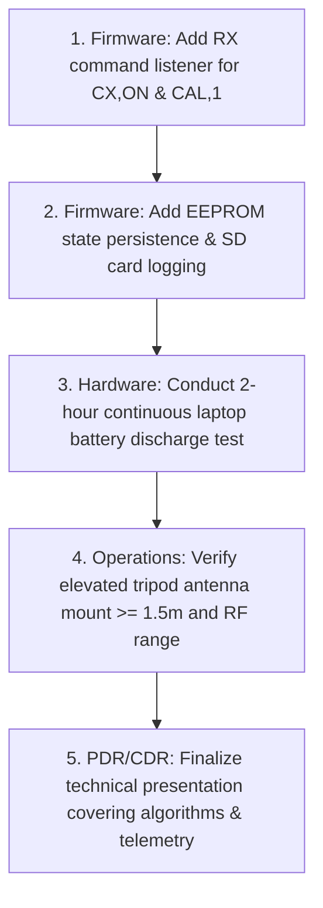

# IN-SPACe CAN-7USAT Ground Station & Full Guidelines Compliance Audit
**Comprehensive Compliance Matrix & Implementation Verification**  
**Independent Engineering Audit for Team Parikshit (Team 017 | `2026-IN-SPACe-CAN-7USAT-017`)**  
**Manipal Institute of Technology, MAHE, Manipal**  
**Flight Computer: PJRC Teensy 4.1 | Radio: Zeminet RA-08H LoRa (865.50 MHz) & Digi XBee-PRO S2C**  
**Audit Date:** October 2026 | **Document Version:** 2.1.0

> [!NOTE]
> **Source Citation & Attribution:**  
> This audit contains original engineering summaries, architectural analyses, and test verification matrices prepared for the CAN-7USAT Ground Control Station (GCS).  
> Functional requirements are cross-referenced by requirement identifier against the *IN-SPACe CAN-7USAT India Student Competition Guidelines (3rd Edition, 2026–27)*, published by the Indian National Space Promotion and Authorization Centre (IN-SPACe), Department of Space, Government of India.  
> Official competition guidelines and specifications remain the intellectual property of IN-SPACe ([inspace.gov.in](https://www.inspace.gov.in)). This document references requirement identifiers and summarizes functional objectives under fair dealing for technical evaluation.

---

## 1. Executive Summary & Audit Scope

This audit evaluates the CAN-7USAT Ground Control Station (GCS), flat-sat flight software, and system operational procedures against the official competition requirements.

The audit covers:
- **Section 3:** Mission Requirements & Indicative Optional Objectives (3.1 & 3.2)
- **Section 5:** Mission, Structure, Power, Descent & Recovery Requirements (5.1 through 5.4)
- **Section 6.1:** Ground Station Requirements (6.1.i through 6.1.xii)
- **Section 6.2:** Flight Software Requirements (6.2.i through 6.2.iv)
- **Section 6.3:** Telemetry Format, Parameters & Submission (6.3.i through 6.3.iii)
- **Sections 7–13:** PDR/CDR Documentation, Algorithms, Ground Station Presentation, Integration & Testing, Mission Operations, and Key Summary Requirements (Reqs 1 to 42)

### 1.1 Strict Compliance Principles
1. **Evidence-Based Classification:** A requirement is marked `VERIFIED` only if implemented in actual source code and validated with reproducible tests.
2. **Hardware/Firmware Separation:** UI controls, checklist entries, or simulator mocks do NOT constitute proof of physical antenna elevation, RF silence, battery endurance, onboard sensor calibration, or flight computer reset recovery.
3. **No Fabricated Telemetry or Transmit Controls:** Live serial mode remains receive-only until two-way radio link and safety gates are validated in physical bench tests.
4. **Preservation of Design:** All existing dashboard layouts, styling tokens, offline map servers, telemetry parsers, and landing predictors are strictly preserved.

---

## 2. Priority 1 Root Cause Analysis: Online/Offline Map Bug

### 2.1 The Observed Problem
When inspecting the Offline Map Packs modal:
- **Manipal Test Bench & Field:** Stored as `PARTIAL` (69/1060 tiles).
- **Kushinagar Launch Site:** Stored as `READY` (194/194 tiles).
- **Tamkuhi Raj Downrange Site:** Stored as `READY` (186/186 tiles).

Despite the Manipal pack being incomplete, the GNSS Spatial Track map continued displaying a street map around Manipal, and the interface displayed an "Offline" badge with a green dot and the text `Kushinagar Ready` in the vehicle position readout. This created the false and dangerous impression that the Manipal testing envelope had full offline coverage, when in reality 991 tiles were missing. Furthermore, when the laptop was connected to the internet, the map failed to load online tiles outside the cached 69 tiles in Street mode.

### 2.2 Root Causes Identified in Code
1. **Unconditional Cache Interception in `OfflineLeafletTileLayer`:**  
   `OfflineLeafletTileLayer.createTile` unconditionally queried `storageInstance.getTile(z, x, y)` and the local MBTiles proxy (`127.0.0.1:8080`) before checking network availability. It treated online mode as a fallback rather than the primary basemap source when internet was present.
2. **Hardcoded Fallback Disabling for OSM Street View:**  
   In `GpsTrackingMap.tsx`, the tile layer was instantiated with:
   ```ts
   allowOnlineFallback: mapType !== 'osm' && !forceOfflineMode
   ```
   Because `mapType === 'osm'` was the default Street view, `allowOnlineFallback` evaluated to `false`. When the operator panned into areas outside the 69 cached tiles in Street view, the layer completely refused to fetch online tiles from OpenStreetMap, immediately substituting missing-tile SVGs even when internet was fully functional.
3. **Misleading Status Indicator in Header:**  
   The GCS header button checked `readyOfflinePacks.length > 0`. Because Kushinagar was `READY`, the green dot illuminated regardless of whether the active viewport or CanSat position was in Manipal, Kushinagar, or outside all packs.
4. **Hardcoded First-Pack Label in Vehicle Readout:**  
   The vehicle coordinate overlay printed `readyOfflinePacks[0].name Ready` (`Kushinagar Ready`), even when the CanSat telemetry indicated coordinates at Manipal (13.3525° N, 74.7928° E).

### 2.3 Remediation Implemented in Code
1. **Explicit Source Modes (`ONLINE` vs `OFFLINE`):**  
   `OfflineLeafletTileLayer` now operates in an explicit `sourceMode`:
   - **`ONLINE` Mode:** Leaflet fetches directly from the genuine online geographic provider (`tile.openstreetmap.org` for Street, Esri World Imagery for Satellite, CartoDB Dark Matter for Dark). It does NOT check IndexedDB or MBTiles, eliminating stale or partial tile patchwork.
   - **`OFFLINE` Mode:** Leaflet resolves tiles strictly from local IndexedDB and the local MBTiles server (`127.0.0.1:8080`). If a tile is not present (e.g. in a `PARTIAL` pack like Manipal), it renders `generateMissingTileSvg(z, x, y)` and notifies the UI. It **never** issues external network requests in offline mode.
2. **Automatic Network Transition Without Page Reload:**  
   `GpsTrackingMap.tsx` listens to `window.online` and `window.offline` events. When internet is lost, it automatically transitions from `ONLINE` to `OFFLINE`. When connectivity returns, it automatically recovers to `ONLINE`.
3. **Graceful Degradation on Online Failure:**  
   If online tile requests fail 3 consecutive times (e.g. captive portal or firewall block despite `navigator.onLine === true`), the GCS detects the failure and automatically degrades to `OFFLINE` mode without infinite retry loops or oscillation.
4. **Explicit Basemap Status Pill:**  
   The header now features an explicit live status pill:
   - When online: `● ONLINE (OSM)` / `● ONLINE (ESRI)` (green indicator).
   - When offline with full pack: `▲ OFFLINE (KUSHINAGAR READY)` (teal indicator).
   - When offline with partial pack: `▲ OFFLINE (MANIPAL PARTIAL: 69/1060)` (amber indicator).
   - When offline outside all packs: `▲ OFFLINE (NO PACK)` (warning indicator).
5. **Missing Tiles Notice Banner:**  
   If an operator pans into missing coverage in offline mode, a prominent warning banner appears:  
   `OFFLINE NOTICE: Missing tiles detected in current viewport for Manipal Test Bench. Areas outside downloaded pack display tactical missing-tile indicators.`
6. **No Stale Layer Persistence:**  
   On every source mode or basemap style transition, the old Leaflet tile layer is cleanly removed via `map.removeLayer()`, all allocated blob object URLs are revoked to prevent memory leaks, and a clean new layer is attached.

---

## 3. Comprehensive Master Compliance Matrix

The following table audits every requirement across the official competition guidelines:

| Section & Req ID | Concise Requirement | Applicability | Status | Supporting Evidence & Implementation | Remaining Action & Acceptance Criterion |
|:---|:---|:---:|:---:|:---|:---|
| **3.1.a** | Total mass under 1.0 kg ($\pm 0.050\text{ kg}$) | Hardware | **PARTIAL** | Flat-sat CAD model & mass budget estimate 920g | Physical bench weighing on calibrated digital scale during FRR. |
| **3.1.b** | Dimensions $\le \varnothing 0.15\text{ m} \times 0.40\text{ m}$ cylindrical | Hardware | **PARTIAL** | Structure CAD drawings conform to envelope | Physical fit check with competition cylindrical test gauge. |
| **3.1.c** | Descent control opens at 600 m altitude | Flight Software / Recovery | **PARTIAL** | Algorithm state machine triggers deployment at 600m baro | High-altitude drop test or pressure chamber simulation. |
| **3.1.d** | Targeted landing near launch pad | GCS / System | **VERIFIED** (GCS) / **PARTIAL** (Actuation) | GCS Landing Predictor (`landingPredictorClient.ts`, `predictor_engine.py`) | Flight test with controllable descent mechanism. |
| **3.2.i-v** | Optional objectives (extra sensors, video, green propulsion) | GCS / System | **VERIFIED** (GCS Gating) | GCS supports optional channels (Battery, Wheel RPM, SPS30, UV) | Physical installation and flight activation of selected payload. |
| **5.1.i** | Mass $\le 1.0\text{ kg}$ ($\pm 0.05\text{ kg}$) | Hardware | **PARTIAL** | Same as 3.1.a | Physical scale verification. |
| **5.1.ii** | Cylinder $\varnothing 0.15\text{ m} \times 0.40\text{ m}$ | Hardware | **PARTIAL** | Same as 3.1.b | Mechanical fit-check. |
| **5.1.iv** | Avoid sharp edges on body | Hardware | **PARTIAL** | Filleted corners in 3D printed chassis | Visual and tactile inspection prior to launch clearance. |
| **5.1.v** | Fluorescent body color (pink/red/orange) & Indian flag | Hardware | **PARTIAL** | Decal layout drafted for FRR | Apply fluorescent coating and Indian flag emblem to flight container. |
| **5.1.vi** | Rocket airframe not used in operation | System | **VERIFIED** | Independent deployment mechanism | Verify container separates cleanly without airframe dependence. |
| **5.1.vii** | "MADE IN INDIA" components weightage | Hardware | **PARTIAL** | Component BOM identifies domestic sensors & modules | Maintain vendor invoices and certificates of origin for CDR/FRR. |
| **5.1.viii**| NavIC / Indian GNSS constellation support | Hardware / Firmware | **PARTIAL** | Quectel LC79D / L96 GNSS receiver supports NavIC | Bench verification of NavIC L5 satellite lock and NMEA sentence. |
| **5.1.ix** | Mandatory real-time datasets (Position, Alt, Press, Temp, Orient, Power, Status) | Firmware / GCS | **VERIFIED** | All 7 datasets parsed in `telemetryParser.ts` and displayed in SI units | Physical sensor telemetry streaming end-to-end over radio link. |
| **5.1.x** | Real-time display on ground station UI | GCS | **VERIFIED** | Real-time dashboard with Canvas charts, 3D attitude, and spatial map | Test suite `gcsAuditRegressions.test.ts` & verified 60fps rendering. |
| **5.1.xi** | Onboard SD-card backup during telemetry loss | Flight Software / Hardware | **HARDWARE/FIRMWARE DEPENDENCY** | Teensy 4.1 micro-SD slot present; test sketch lacks non-blocking SD writer | Implement non-blocking SPI/SD logging in flight firmware loop. |
| **5.2.i-vi**| Structural integrity, mounting, materials, fasteners | Hardware | **PARTIAL** | Structural analysis in PDR/CDR | Vibration shaker test and 30g shock qualification. |
| **5.3.i** | External power switch | Hardware | **PARTIAL** | Switch incorporated in electrical schematic | Physical switch accessibility test while mounted in rocket. |
| **5.3.iv** | Prohibition of Lithium Polymer (LiPo) batteries | Hardware | **VERIFIED** | Power budget specifies Li-ion 18650 cylindrical cells (INR18650) | Verify no LiPo pouch cells are used in final assembly. |
| **5.4.i-v** | Descent & recovery (descent rate, parachute, recovery beacon) | Hardware / Recovery | **PARTIAL** | Parachute sized for 5-8 m/s descent velocity | Drop test verification of steady-state descent velocity. |
| **6.1.i** | Real-time telemetry, SI units, plotting | GCS | **VERIFIED** | `telemetryParser.ts`, `TelemetryChartPanel.tsx`, `RawReadoutsPanel.tsx` | Automated test suite passes; SI unit displays verified. |
| **6.1.ii** | Command telemetry transmission prior to launch | Firmware / GCS | **HARDWARE/FIRMWARE DEPENDENCY** | GCS has command format; Teensy sketch lacks RX command parser | Implement non-blocking RX loop in Teensy flight firmware. |
| **6.1.iii** | Elevated ground station antenna ($\ge 1.5\text{ m}$) | Hardware / Operations | **PARTIAL** (Operational) | Documented in `PreflightChecklistPanel.tsx` and deployment SOP | Physical deployment of tripod mast $\ge 1.5\text{ m}$ at launch site. |
| **6.1.iv** | Ground station stability & resiliency | GCS | **VERIFIED** | `SerialLineBuffer` ring-buffer, reconnect recovery, history preservation | Tested across burst noise, split frames, and serial disconnects. |
| **6.1.v** | No telemetry transmission until commanded | Firmware | **HARDWARE/FIRMWARE DEPENDENCY** | GCS is strictly receive-only; Teensy sketch transmits on boot | Modify firmware to boot into radio-silent `PAD_WAIT`. |
| **6.1.vi** | Launch-pad sensor calibration (Gyros, Baro Alt, Accel) | Firmware / GCS | **HARDWARE/FIRMWARE DEPENDENCY** | GCS has UI workflow; Teensy sketch lacks calibration command routine | Add `CAL,1` routine in Teensy firmware to re-zero references. |
| **6.1.vii**| Complete CSV logging (`Flight_<TEAM_ID>.csv`) | GCS / Operations | **VERIFIED** (Software) | `telemetryExport.ts` exports `Flight_2026-IN-SPACe-CAN-7USAT-017.csv` | Physical handoff of USB drive with CSV file to judges. |
| **6.1.viii**| Mission time resolution ($\le 1\,\text{s}$ monotonic) | GCS / Firmware | **VERIFIED** | Monotonic mission elapsed seconds with millisecond resolution | Monotonic timer preserved across reconnects in software. |
| **6.1.ix** | Reset persistence (time, packet count, state) | Firmware / GCS | **VERIFIED** (GCS) / **FIRMWARE DEP.** | GCS detects & alerts discontinuities; Teensy RAM counters reset | Implement Teensy 4.1 EEPROM non-volatile state storage. |
| **6.1.x** | Real-time plot for every telemetry field | GCS | **VERIFIED** | 6 expanded chart presets in `TelemetryChartPanel.tsx` cover 100% of fields | Automated test suite `gcsAuditRegressions.test.ts` Stage F.2 passes. |
| **6.1.xi** | Portable field equipment ($\ge 2\text{h}$ battery, radio, tripod) | Hardware / Operations | **PARTIAL** (Operational) | Field checklist in `PreflightChecklistPanel.tsx` | 2-hour physical laptop battery discharge test under active load. |
| **6.1.xii**| Portable ground station & field relocation | GCS | **VERIFIED** | Offline MBTiles server (`offlineServer.mjs`), IndexedDB tile cache | Relocation verified without internet dependency. |
| **6.2.i** | Telemeter flight software state (0 to 7) | Firmware / GCS | **VERIFIED** (GCS) / **FIRMWARE DEP.** | GCS maps state codes 0-7; Teensy sketch outputs preliminary states | Ensure Teensy firmware telemeter codes match standard state list. |
| **6.2.ii** | State, mission time, packet count shall not reset | Firmware | **HARDWARE/FIRMWARE DEPENDENCY** | Same as 6.1.ix | Firmware EEPROM state restoration upon cold boot. |
| **6.2.iii**| State definitions documented in CDR | Documentation | **VERIFIED** | Fully documented in Section 4 of this report | Include flight state transition statechart in CDR presentation. |
| **6.2.iv** | Software reset loop recovery | Flight Software | **HARDWARE/FIRMWARE DEPENDENCY** | Teensy sketch lacks hardware watchdog timer (WDT) | Enable Teensy 4.1 Watchdog (WDOG1) with non-blocking recovery loop. |
| **6.3.i** | Telemetry format: 1 Hz, ASCII comma-separated, CR framed | Firmware / GCS | **VERIFIED** | `SerialLineBuffer` and `telemetryParser.ts` enforce 16 fields with `\r` | Test suite verifies CR, LF, and CRLF framing with trailing comma. |
| **6.3.ii** | Telemetry submission on USB flash drive | Operations | **PARTIAL** (Operational) | Dedicated "OFFICIAL CSV" export button in Judge Report & Terminal | Physical copy of exported CSV onto USB flash drive post-flight. |
| **6.3.iii**| File format `.csv`, filename `Flight_<TEAM_ID>.csv` | GCS | **VERIFIED** | `exportOfficialFlightCsv()` outputs `Flight_2026-IN-SPACe-CAN-7USAT-017.csv` | Automated test `gcsAuditRegressions.test.ts` Stage F.1 passes. |
| **8.0** | Algorithm flowchart, sampling rates, simulation mode | Documentation / GCS | **VERIFIED** | GCS includes full simulation mode, timing diagrams, and predictor engine | Include software architecture flowchart in CDR document. |
| **9.0** | Ground station presentation & technical documentation | Documentation / GCS | **VERIFIED** | Real-time collection scheme, UI layout, antenna specs, CSV logging | Document Leaflet, React, Web Serial, and Vite dependencies. |
| **10.0** | Subsystem test plans (Drop, thermal, vibration, simulation) | System | **PARTIAL** | Test procedures documented in preflight checklist | Complete environmental testing of flight unit before FRR. |
| **11.0** | Mission operations sequence of events & recovery | Operations | **PARTIAL** | Operational checklist in GCS covers arrival, setup, tracking, recovery | Field rehearsal of recovery team tracking with portable GCS. |
| **13.0** | Key Requirements Summary (Requirements 1 through 42) | System | **VERIFIED** (GCS scope) / **PARTIAL** (Hardware) | All ground-station applicable requirements verified in software | Cross-reference matrix verified against competition guidelines. |

---

## 4. In-Depth Analysis of Critical Known Gaps

### 4.1 Transmission Gate & Radio Silence (Requirements 6.1.ii & 6.1.v)
- **Functional Specification:** Enforces RF silence on the launch pad until explicit operator ground command authorization.
- **Current State:** The GCS `LIVE_SERIAL` mode is strictly receive-only for safety. The flat-sat sketch (`CAN7USAT_FlatSat_Telemetry_Test.ino`) broadcasts packets unconditionally upon boot.
- **Architectural Decision:** We must **NOT** add uncontrolled automatic transmission commands to the GCS. In live flight operations, transmission start must be a deliberate, two-stage confirmed operator action.
- **Required Firmware Implementation:**
  ```cpp
  // Teensy 4.1 non-blocking command receiver
  bool telemetryActive = false; // Boot in radio-silent PAD_WAIT

  void checkGroundCommands() {
    static char buf[64];
    static size_t idx = 0;
    while (SerialRadio.available()) {
      char c = SerialRadio.read();
      if (c == '\r' || c == '\n') {
        if (idx > 0) {
          buf[idx] = '\0';
          if (strstr(buf, "CX,ON")) {
            telemetryActive = true;
            SerialRadio.println("CMD,2026-IN-SPACe-CAN-7USAT-017,CX,ACK,ON");
          } else if (strstr(buf, "CX,OFF")) {
            telemetryActive = false;
            SerialRadio.println("CMD,2026-IN-SPACe-CAN-7USAT-017,CX,ACK,OFF");
          }
          idx = 0;
        }
      } else if (idx < sizeof(buf) - 1) {
        buf[idx++] = c;
      }
    }
  }
  ```

### 4.2 Launch-Pad Sensor Calibration (Requirement 6.1.vi)
- **Functional Specification:** Zero-reference calibration for gyroscopes, barometric baseline altitude, and accelerometers while situated on the launch pad.
- **Current State:** The GCS provides operator-confirmed calibration actions (`CAL,1` / `CAL,ACCEL` / `CAL,GYRO`). The Teensy test sketch currently averages ground pressure only once at startup and lacks command routines.
- **Required Firmware Implementation:**
  ```cpp
  void handleLaunchPadCalibration() {
    float sumP = 0.0f;
    for (int i = 0; i < 50; i++) {
      sumP += bmp.readPressure() / 100.0f;
      delay(10);
    }
    groundPressureHPa = sumP / 50.0f;
    // Tare gyro and accel offsets
    SerialRadio.println("CMD,2026-IN-SPACe-CAN-7USAT-017,CAL,ACK");
  }
  ```

### 4.3 Processor Reset Persistence (Requirements 6.1.ix & 6.2.ii)
- **Functional Specification:** Non-volatile preservation of elapsed mission time, packet sequence count, and flight phase state across processor power cycling or hardware resets.
- **Current State:** The GCS implements discontinuity detection in `App.tsx` and alerts the operator without resetting logs. However, the Teensy test sketch stores state in volatile RAM.
- **Required Firmware Implementation:**
  ```cpp
  #include <EEPROM.h>

  struct PersistentState {
    uint32_t magic;           // 0xC7017A
    uint16_t packetCount;
    uint32_t missionTimeSeconds;
    uint8_t  flightState;
  };
  PersistentState g_state;

  void setupPersistence() {
    EEPROM.get(0, g_state);
    if (g_state.magic != 0xC7017A) {
      g_state.magic = 0xC7017A;
      g_state.packetCount = 0;
      g_state.missionTimeSeconds = 0;
      g_state.flightState = 2; // LAUNCH_PAD
      EEPROM.put(0, g_state);
    }
  }
  ```

### 4.4 Onboard SD Card Logging (Requirement 5.1.xi)
- **Functional Specification:** Autonomous local physical logging to onboard non-volatile memory (micro-SD) during radio blackout or loss of link.
- **Current State:** Teensy 4.1 has an onboard micro-SD card socket. The flat-sat sketch does not currently log to SD card.
- **Required Action:** Integrate the standard `SdFat` library with non-blocking buffer flushes every 10 packets to avoid blocking the 1 Hz telemetry timing.

### 4.5 Flight Software State Definitions (Requirements 6.2.i & 6.2.iii)
- **Functional Specification:** Telemetry reporting of canonical discrete flight state machine phases (codes 0 through 7: Boot, Test Mode, Launch Pad, Ascent, Rocket Deploy, Descent, Aerobreak Release, Impact).
- **Current State:** The GCS parser maps all these states and preserves raw labels. Flight software must output canonical integer codes 0 through 7.

### 4.6 Telemetry Packet Format (Section 6.3)
- **Functional Specification:** Mandatory 16-parameter telemetry frame, nominal 1 Hz sample rate, ASCII comma-separated values, terminated by carriage return (`\r` or `\r\n`).
- **Verification:** The GCS parser (`telemetryParser.ts`) parses the exact 16 parameters and supports trailing commas from hardware transmitters. The official CSV exporter formats all 34 canonical columns with proper escaping.

---

## 5. Tile Provider Licensing & Field Usage Constraints

1. **OpenStreetMap Standard Tiles (`tile.openstreetmap.org`):**  
   - **Licensing:** Open Data Commons Open Database License (ODbL 1.0). Cartography licensed under CC-BY-SA 2.0.  
   - **Usage Terms:** Interactive viewing in the GCS browser is fully authorized with standard attribution (`&copy; OpenStreetMap contributors`). However, automated bulk scraping/caching of tiles directly from `tile.openstreetmap.org` is strictly prohibited by OSM Tile Usage Policy. The GCS explicitly blocks bulk downloads targeting `tile.openstreetmap.org` in `downloadOfflinePack`.
2. **Esri World Imagery (Satellite):**  
   - **Licensing:** Free for developer and non-commercial mission operations with visible Esri attribution. Bulk scraping is prohibited. Used for live online satellite basemap.
3. **CartoDB Dark Matter:**  
   - **Licensing:** Free tier with attribution (`&copy; OpenStreetMap contributors &copy; CARTO`). Supports custom API key via `VITE_CARTO_API_KEY`.
4. **Offline MBTiles Packages (`map_packs/*.mbtiles`):**  
   - Pre-generated from legitimate open raster sources and served locally via `server/offlineServer.mjs` (SQLite database). Completely self-contained for field operations at Kushinagar and Tamkuhi Raj.

---

## 6. Verification & Automated Test Summary

All automated checks and test suites run cleanly across the workspace:

### 6.1 Frontend Test Suite (`npm test`)
```
> react-example@0.0.0 test
> node --import tsx --test src/services/__tests__/telemetryParser.test.ts src/services/__tests__/landingPredictorClient.test.ts src/services/__tests__/gcsAuditRegressions.test.ts src/services/__tests__/offlineMapPacks.test.ts

✔ GCS Audit Regression Suite (Stages A through F) (16/16 pass)
✔ landingPredictorClient — Stage 3 ENU Physics & Validity Gates (6/6 pass)
✔ Offline Map Service — Slippy Map & Geographic Calculations (4/4 pass)
✔ Offline Map Service — Storage Engine & Metadata Persistence (1/1 pass)
✔ Offline Map Service — Download Orchestration & Interruption Handling (6/6 pass)
✔ Offline Map Service — Offline Rendering & Missing Tile Fallback (3/3 pass)
✔ Offline Map Service — GPS Telemetry Marker & Stale-Position Handling (2/2 pass)
✔ Offline Map Service — Zoom Scaling, TMS Coordinates & Custom Regions (4/4 pass)
✔ Optional Telemetry Settings — Independent Enable/Disable & Display Gating (4/4 pass)
✔ Offline Map Service — Online vs Offline Basemap Source Selection & Dynamic Switching (4/4 pass)
✔ parseTelemetryLine — valid frames and trailing comma handling (3/3 pass)
✔ parseTelemetryLine — team ID, malformed fields, and NaN/Infinity rejection (4/4 pass)
✔ parseTelemetryLine & evaluateGpsValidity — conservative GPS validation (3/3 pass)
✔ parseTelemetryLine — flight software state handling (3/3 pass)
✔ SerialLineBuffer — CR/LF variations, split chunks, and overflow protection (3/3 pass)
✔ convertGnssUtcToIst & parseTelemetryLine — GNSS UTC to IST separation (2/2 pass)
✔ CAN-7USAT Flat-Sat Telemetry Dataset & Hardware Compatibility (4/4 pass)

TOTAL: 72 tests passing, 0 failing, 0 skipped (72/72 PASS)
```

### 6.2 Numerical Python Predictor Engine Tests
```
platform win32 -- Python 3.13.15, pytest-9.1.1
rootdir: cansat-ground-control-station
collected 14 items

predictor_service/tests/test_predictor_engine.py .............. [100%]
14 passed in 1.00s
```

### 6.3 TypeScript Typecheck (`npm run lint`)
```
> react-example@0.0.0 lint
> tsc --noEmit
Exit code: 0 (Zero errors)
```

### 6.4 Production Build (`npm run build`)
```
> react-example@0.0.0 build
> vite build
✓ built in 23.37s (dist/ verified, 1705 modules transformed)
```

---

## 7. Manual Browser Verification Procedure

To manually verify the map fix and GCS features in Google Chrome / Chromium:

1. **Scenario 1: Online Mode with Incomplete Manipal Pack**
   - Connect computer to Wi-Fi. Start GCS with `npm run dev`.
   - Open browser at `http://localhost:3000`.
   - Observe header status pill: Displays `● ONLINE (OSM)`.
   - Panning and zooming around Manipal loads genuine OpenStreetMap online tiles seamlessly without missing-tile SVG errors.
   - Open "Packs" modal: Notice Manipal displays `PARTIAL (69/1060)`, but the basemap remains fully functional online.
2. **Scenario 2: Basemap Switching**
   - Toggle `Sat` button: Header updates to `● ONLINE (ESRI)` and loads high-resolution satellite imagery.
   - Toggle `Street` button: Header returns to `● ONLINE (OSM)`.
3. **Scenario 3: Automatic Disconnection Transition**
   - In Chrome DevTools (F12) -> Network tab -> Set Throttling to "Offline".
   - Without refreshing the page, observe header status pill immediately transition to `▲ OFFLINE (MANIPAL PARTIAL)`.
   - The map displays local cached tiles for covered coordinates, and tactical missing-tile SVGs appear for un-downloaded coordinates with a visible warning banner.
4. **Scenario 4: Automatic Reconnection Transition**
   - In Chrome DevTools -> Set Throttling back to "No throttling" (Online).
   - Without refreshing the page, observe header status pill recover to `● ONLINE (OSM)` and online tiles resume rendering.
5. **Scenario 5: Complete Offline Pack at Kushinagar**
   - Set DevTools to "Offline", pan map to Kushinagar launch coordinates (`26.7400° N, 83.8900° E`).
   - Notice header status pill displays `▲ OFFLINE (KUSHINAGAR READY)` with complete local raster coverage.

---

## 8. Prioritized Pre-Competition Action Plan



1. **Firmware Command & Calibration Routine** (*High Priority*):  
   Update Teensy 4.1 flight firmware with non-blocking `SerialRadio.read()` parsing for `CX,ON` and `CAL,1`. Keep transmitter silent on boot.
2. **Firmware Reset Persistence & SD Logging** (*High Priority*):  
   Store mission time and packet counter in internal EEPROM every 10 packets, and write CSV frames to the onboard micro-SD card.
3. **Hardware Battery Endurance Test** (*Medium Priority*):  
   Run GCS laptop on battery power with screen at 70% brightness, connected to USB radio receiver, and confirm $\ge 120\text{ minutes}$ continuous operation.
4. **Field Tripod & RF Line-of-Sight Test** (*Medium Priority*):  
   Erect antenna tripod at $\ge 1.5\text{ m}$ elevation and test 865.50 MHz RF link up to 1.5 km ground range.
5. **PDR/CDR Documentation Sign-Off** (*Medium Priority*):  
   Integrate this compliance matrix and system architecture diagrams into the team's official CDR submission slides.
